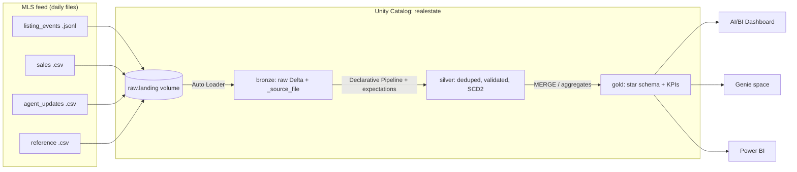

# Real Estate Market Lakehouse on Databricks

An end-to-end lakehouse for an MLS-style real estate feed (listings, price changes, closed sales, agents and mortgage rates), built on Databricks in 30 days. It covers both roles:

- **Data engineering:** incremental ingestion (Auto Loader), medallion architecture on Delta Lake, data-quality expectations, CDC and SCD Type 2, orchestration (Lakeflow Jobs), CI/CD (Asset Bundles), governance (Unity Catalog).
- **BI engineering:** star schema, governed market KPIs (metric views), AI/BI dashboards, Genie, Power BI, row-level security.



## Repo layout

```
data/
  generate_data.py          deterministic generator (seed 42); rerun to rebuild data
  reference/                markets, offices, agents, properties, mortgage rates
  landing/                  90 daily files per feed, 2026-07-01 to 2026-09-28
notebooks/
  _config.py                catalog name, paths (edit CATALOG here)
  week1_foundations/        setup, landing, exploration, bronze + Delta, Spark internals, SQL
  week2_data_engineering/   Auto Loader, silver, SCD2, declarative pipeline, tuning, jobs
  week3_bi/                 gold star schema, metric views, dashboards, Genie, Power BI, security
  week4_production/         bundles, monitoring, system tables, tests
notes/
  interview_log.md          your daily "how I'd explain it" notes
```

## Quick start

1. Push this repo to GitHub.
2. In Databricks (Free Edition works): **Workspace → Create → Git folder** and paste the repo URL.
3. Open `notebooks/week1_foundations/00_setup` and run it on serverless compute.
4. Run `01_land_files` with `through_date = 2026-07-07` to land the first week of files.
5. Continue through the Week 1 notebooks in order.

To regenerate the data locally: `python data/generate_data.py`.

## The data (synthetic, with real-world problems on purpose)

| Feed | Rows | Built-in problems |
| --- | --- | --- |
| listing_events (JSON lines) | 9,788 | duplicates, null/negative prices, missing property_id, schema evolution from 2026-08-15 |
| sales (CSV) | 1,371 | 10% late-arriving, 2% corrections (`record_version` 2) |
| agent_updates (CSV) | 23 | office moves and new hires, for SCD Type 2 |
| properties / markets / offices / agents / rates | 6,000 / 40 / 16 / 160 / 14 | region column drives row-level security |

## KPIs the gold layer serves

| KPI | Definition |
| --- | --- |
| Active inventory | Listings whose current status is Active, as of a date |
| New listings | NEW events per period |
| Days on market (DOM) | close_date minus list_date, for sold listings |
| List-to-sale ratio | sale_price / final list_price |
| Price-cut rate | Share of listings with at least one PRICE_CHANGE downward |
| Months of supply | Active inventory / average monthly closed sales |
| Agent volume | Sum of sale_price, listing side + buyer side |

## Status

- [x] Week 1: foundations (notebooks included)
- [ ] Week 2: data engineering
- [ ] Week 3: BI engineering
- [ ] Week 4: production + interview prep
